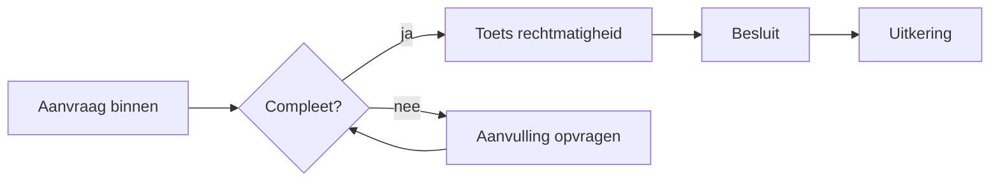
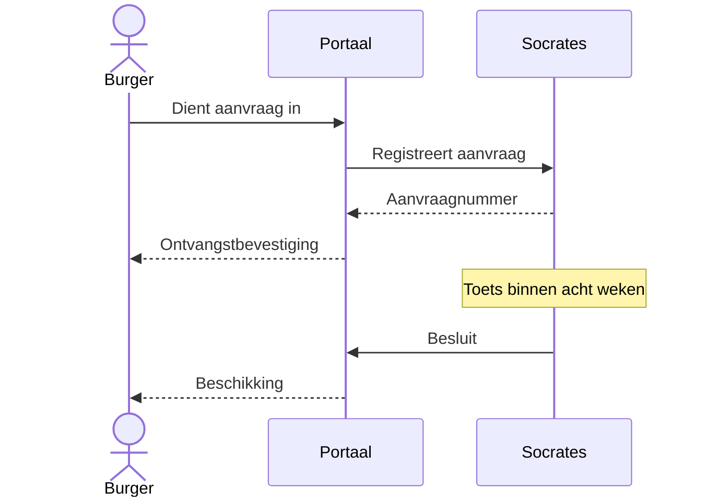
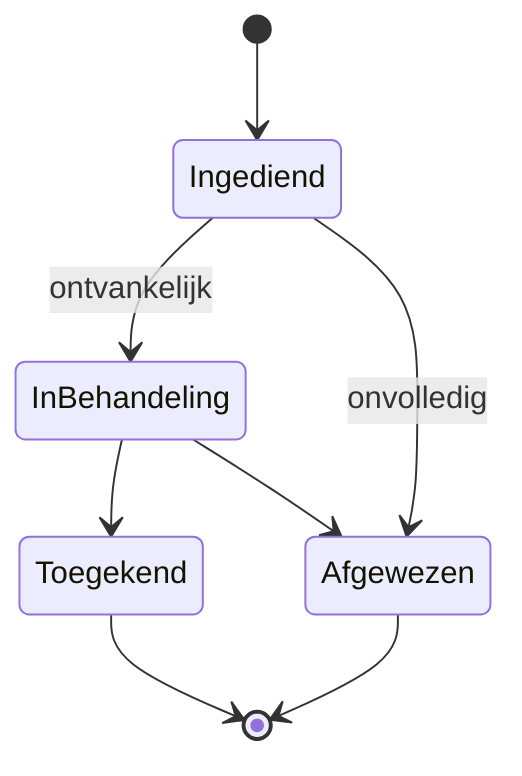
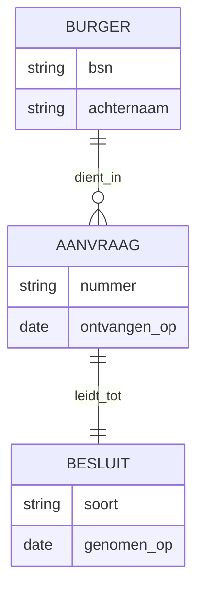
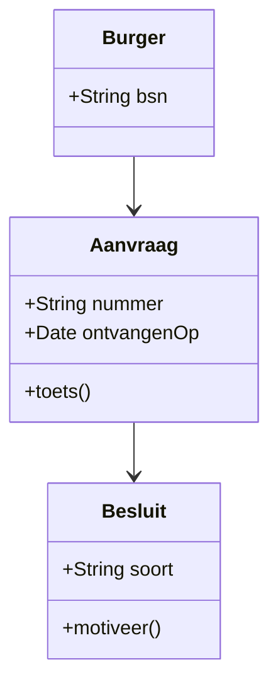
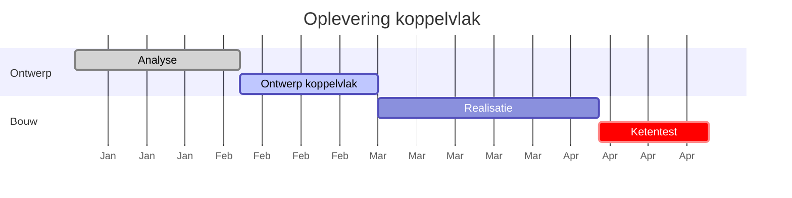
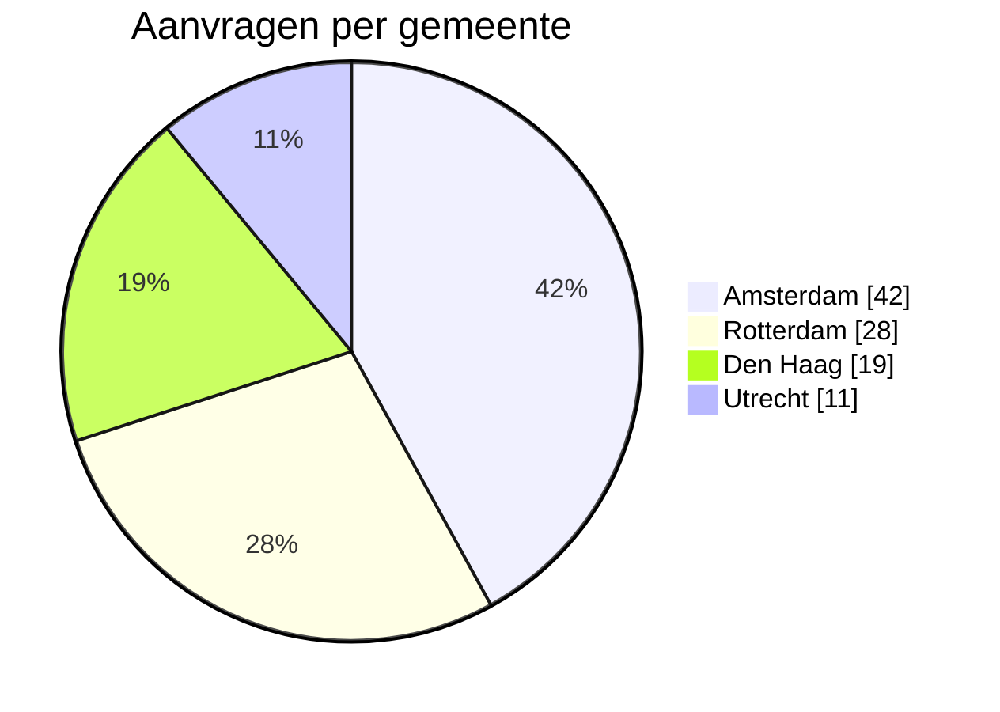
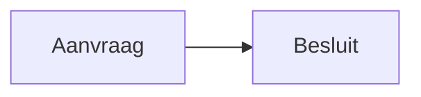
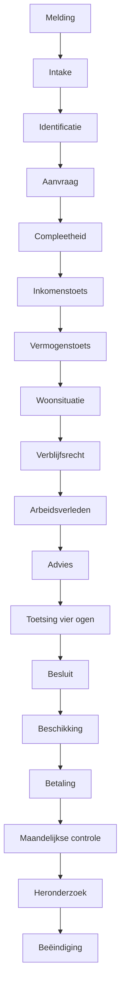
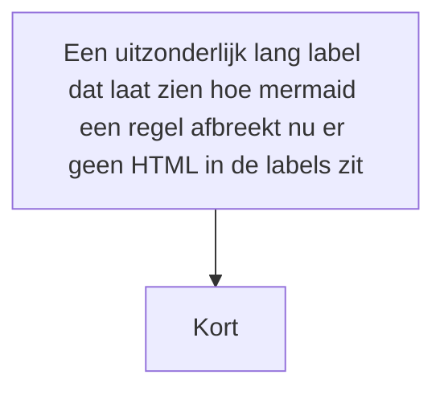

| Versie | Datum | Wijziging |
| --- | --- | --- |
| 0.1 | 12 augustus 2026 | Eerste opzet |
| 0.2 | 12 augustus 2026 | Diagrammen toegevoegd |

# Testdocument PDF-tool

Dit bestand hoort bij de PDF-tool zoals `examples/deck-test.md` bij de deck-tool hoort: elk
diagramtype dat we ondersteunen staat erin, plus de randgevallen. Laad het na een wijziging in
`scripts/mermaid-render.js`, `scripts/pdf-builder.js` of `styles/pdf.css` en kijk of alles er nog
staat, in de preview én in een echte print naar PDF.

Zet bij het exporteren **Achtergrondafbeeldingen** aan, anders mis je het voorblad.

<!-- pagebreak -->

## De zeven types die we nalopen

### Flowchart



### Sequence



### State



<!-- pagebreak -->

### ER



### Class



### Gantt



### Pie



<!-- pagebreak -->

## Randgevallen

### Onderschrift met tekens die geëscaped moeten worden

Hieronder hoort het onderschrift letterlijk te staan, inclusief de aanhalingstekens en de ampersand.



### Diagram dat hoger is dan een pagina

Dit moet automatisch meeschalen en heel blijven. Wordt het afgesneden, dan klopt de breedteberekening
in `normalizeDiagramSvg` niet meer.



### Lang label

Met `htmlLabels: false` breekt mermaid de regel zelf af. Hier zie je of dat nog binnen het vakje
past.



### Kapotte syntax

Hieronder hoort een nette melding te staan met de broncode eronder, en de rest van het document moet
gewoon doorlopen.

```mermaid
flowchart LR
  A[Onafgesloten haak --> B
```

### Onbekend diagramtype

```mermaid
stroomschema LR
  A --> B
```

### Leeg blok

```mermaid
```

### Gewoon codeblok, moet onaangeraakt blijven

```js
const md = window.markdownit({ highlight: mermaidFence });
```

```
Een blok zonder taal. Hier hoort niets aan te veranderen.
```

## Afsluiting

Staat alles hierboven goed in de PDF, inclusief de pijlpunten in de flowchart en de sequence, dan
doet de change wat hij moet doen. De pijlpunten zijn de belangrijkste: die hangen aan `url(#...)` en
zijn het eerste wat sneuvelt als de id's tussen preview en export door elkaar lopen.
