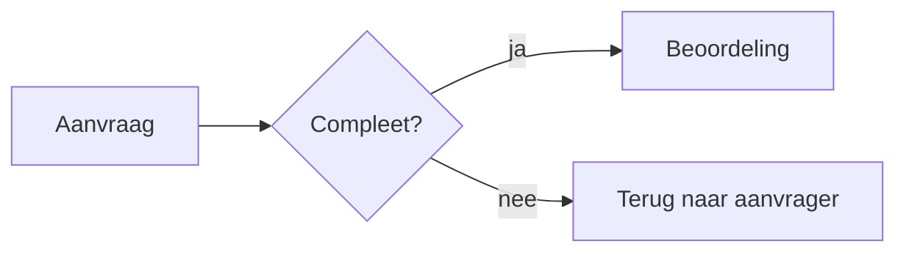

# Document-syntax

Kort verhaal: gewone markdown, één marker, en verder niets te leren. De opmaak valt er in de tool
overheen. Je bestand blijft leesbaar in elke andere markdown-viewer.

De officiële versie staat op https://wigo4it-brandbook.azurewebsites.net/pdf-syntax.html

## Geen tokens

Anders dan bij een deck staat er niets van de huisstijl in je bestand. Koppen, lijsten, tabellen,
links, vet en cursief gaan er zo in. Verzin geen HTML, geen CSS-klassen en geen frontmatter: die
worden niet gebruikt en komen als tekst in beeld.

## Wat je koppen bepalen

| Kop | Gevolg |
| --- | --- |
| `#` | de eerste is de documenttitel |
| `##` | komt in de inhoudsopgave, met paginanummer |
| `###` en dieper | blijft uit de inhoudsopgave |

Alles wat vóór de eerste `#` staat, zoals een versietabel of changelog, komt als voorwerk op een
eigen pagina vóór de inhoudsopgave. Dat gaat over het document en niet over de inhoud.

Bouw je koppenstructuur naar de inhoudsopgave toe: `##` voor hoofdstukken, `###` voor alles
daarbinnen. Een inhoudsopgave met dertig regels helpt niemand.

## Pagina-einde afdwingen

Zet de marker op een eigen regel. Alles daarna begint op een nieuwe pagina.

```markdown
Laatste alinea van dit hoofdstuk.

<!-- pagebreak -->

## Volgend hoofdstuk
```

`<!-- pagebreak -->` is de nette vorm: in andere viewers is het een comment en zie je er niets van.
`<pagebreak>` en `\pagebreak` werken ook. Noem je de marker midden in een zin, dan blijft het
gewoon tekst.

Zet er een voor elk `##`-hoofdstuk zodra het document langer is dan een pagina of vijf. Bij een
memo van twee kantjes doe je dat niet.

## Diagrammen met mermaid

Een codeblok met `mermaid` als taal wordt een diagram in de huisstijl. Tekst achter `mermaid` op
de openingsregel wordt het onderschrift.

````markdown

````

Getest zijn flowchart, sequence, state, ER, class, gantt en pie. Kleuren en fonts komen uit het
thema; laat `%%{init}%%`- en `style`-regels weg, die werken het thema tegen. Een te hoog diagram schaalt naar de
paginahoogte, dus houd het compact. Gebruik een diagram waar het een proces of structuur
verduidelijkt, niet als decoratie.

## De rest zet de gebruiker in de tool

Dit hoort niet in je markdown, maar noem het wel bij de oplevering:

| Instelling | Keuze |
| --- | --- |
| Voorblad | Groen, Aubergine, Wit of Geen |
| Titel op voorblad | vrije tekst |
| Ondertitel | optioneel |
| Datum op voorblad | optioneel |
| Inhoudsopgave toevoegen | aan of uit |
| Footer per pagina | optioneel, bijvoorbeeld "Vertrouwelijk" |

Doe een voorstel voor deze velden in je oplevering. Bijvoorbeeld: "Voorblad groen, titel
*Jaarplan 2026*, ondertitel *Van output naar outcome*, inhoudsopgave aan, footer leeg."

## Exporteren

De knop "Exporteer naar PDF" opent het printvenster van de browser. Daar kiest de gebruiker
"Opslaan als PDF" en zet **Achtergrondafbeeldingen** aan. Zonder dat vinkje verdwijnt het gekleurde
voorblad en komt er een wit vel uit. De paginanummers in de inhoudsopgave worden pas tijdens het
opmaken ingevuld, dus bij een lang document duurt het even.

## Opbouw die werkt

Voor een memo of notitie:

```
# Titel
korte alinea: waar gaat dit over en wat is de vraag
## Wat er speelt
## Wat we voorstellen
## Wat dat betekent
## Wat we van je vragen
```

Voor een rapport of plan: voorwerk met versietabel, dan `#` titel, dan een samenvatting van een
halve pagina, dan de hoofdstukken. Zet de conclusie vooraan, niet achteraan. Mensen lezen de eerste
pagina en bladeren de rest door.
